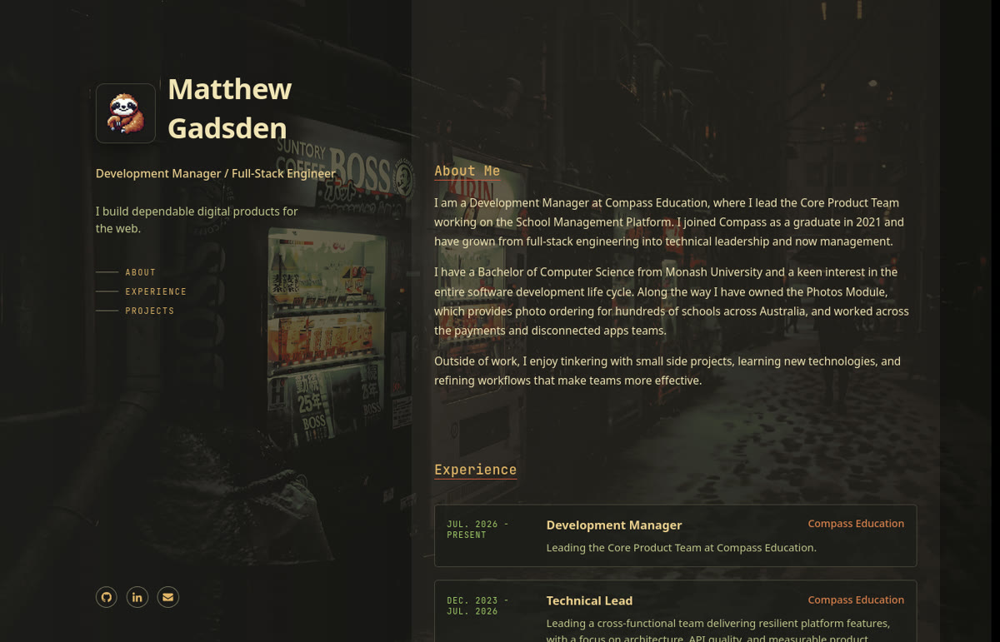

<p align="center">
  <a href="https://matthewgadsden.dev">
    
  </a>
</p>
<h1 align="center">
  Portfolio
</h1>

<div align="center">
  
  
  
  
  
</div>

<div align="center">
  
  
  
</div>

<p align="center">
  My personal portfolio site, themed with <a href="https://tokyo-snow.matthewgadsden.dev">Tokyo Snow</a>.
  <br/>
  <a href="https://matthewgadsden.dev"><b>matthewgadsden.dev</b></a>
</p>

<p align="center">
  <a href="https://matthewgadsden.dev">
    
  </a>
</p>

A single-page site built with React 19, TypeScript and Vite, with Bun as the package manager. There's no router, state management or test suite.

## Getting started

```bash
bun install
bun run dev
```

## Commands

| Command | What it does |
| --- | --- |
| `bun run dev` | Start the Vite dev server |
| `bun run build` | Type-check with `tsc -b`, then build to `dist/` |
| `bun run lint` | Run ESLint |
| `bun run preview` | Serve the built `dist/` |

CI runs `lint` and then `build`, so both need to pass before a deploy goes out.

## Editing content

The whole page lives in `src/App.tsx`. Jobs and projects are the `experience` and `projects` arrays at the top of the component, so adding one means adding an entry there rather than a new component.

- Experience descriptions are rendered as HTML, so use `<br/>` for line breaks. Project descriptions are plain text.
- Project thumbnails go in `src/assets/projects/`. Each project sets `fit` to `'cover'` or `'contain'` for how its thumbnail is sized.
- `contribution: true` adds a "Contribution" badge, for repos owned by someone else.

## Styling

The styles are plain CSS in `src/styling/`:

- `tokyo_snow.css` is the theme. It defines the Tokyo Snow palette (`--brick`, `--ember`, `--snow` and the rest), the semantic tokens built from it (`--text-*`, `--bg-*`, `--border-*`, `--accent`), and the background image. It's dark only.
- `index.css` holds the layout and component styles. It only uses the semantic tokens, never the palette directly, so the theme can be swapped by replacing `tokyo_snow.css`.

## Deploying

`.github/workflows/deploy.yml` lints, builds, and deploys `dist/` to the `portfolio-site` Cloudflare Pages project as a production build. It runs when a `v*` tag is pushed, or by hand from the Actions tab. Pushes to `main` don't deploy.

```bash
git tag v1.2.2
git push origin v1.2.2
```

The workflow needs `CLOUDFLARE_API_TOKEN` and `CLOUDFLARE_ACCOUNT_ID` set as repository secrets.
